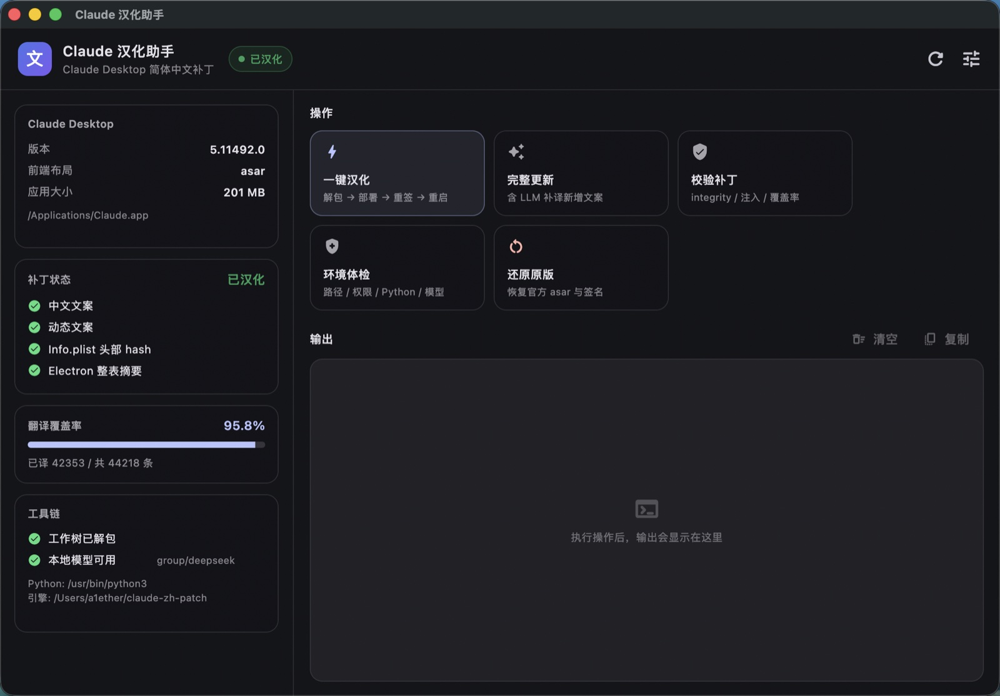

# Claude Desktop 中文汉化补丁

为 Mac 版 Claude Desktop（4.42xx 起，前端打包成 `ion-dist.asar`）添加简体中文界面，
含完整中文翻译质量工具链。



## 下载即用（Release）

不想碰命令行的话，直接从 [Releases](https://github.com/A1ether/claude-zh-patch/releases)
下载 `ClaudeHans-<版本>.zip`：

1. 解压，把 `ClaudeHans.app` 拖进「应用程序」
2. 首次打开：**右键 →「打开」**（未做 Apple 公证，双击会被拦一次），或先执行
   `xattr -dr com.apple.quarantine /Applications/ClaudeHans.app`
3. 点「一键汉化」。系统会问「ClaudeHans 想修改其他 App」，允许即可
4. Claude 启动后：左下角账户 →「语言」→ 选「中文（简体）」

release 包里**已经内置汉化引擎**（脚本 + 翻译数据），不需要 clone 仓库。唯一的系统依赖是
Python ≥ 3.9 —— macOS 自带的 `python3` 或 `xcode-select --install` 装上的那个就够了；
找不到时界面会直接给出安装命令和复制按钮。

> 内置引擎首次启动会复制到 `~/Library/Application Support/claude-zh-patch/engine`：
> app 包内不能写（会破坏代码签名），工作树 `.work/` 也生成在那份可写副本里。
> 如果你自己 clone 了仓库，GUI 会优先用仓库目录，行为和命令行完全一致。

自己发包：`cd gui && ./tool/make_release.sh`（编译 → 内置引擎 → ad-hoc 重签 → `dist/*.zip`）。

## 环境要求

| 项 | 要求 | 说明 |
|---|---|---|
| 系统 | **macOS** | 依赖 `codesign` / `Info.plist` / asar 校验，暂无其他平台实现 |
| Python | **≥ 3.9** | 系统自带的 3.9 即可（缺了就先 `xcode-select --install`）；`brew install python@3.13` 也行 |
| 命令行工具 | Xcode CLT | `xcode-select --install`，提供 `codesign` |
| 权限 | 对 `Claude.app` 可写 | 用户自己安装的即可；root 属主时用 sudo 或装到 `~/Applications` |
| 可选 | OpenAI 兼容端点 | 仅 LLM 补译需要；没有会自动跳过，不影响应用汉化 |
| 可选 | Flutter ≥ 3.27 | 只在需要编译图形界面时需要 |

环境不满足时各入口都会给出明确的修复提示，也可以随时跑 `python3 zh_patch.py doctor` 体检。

### 换机器 / 换安装位置

代码里没有写死用户名或工程路径（工程目录由脚本位置推断），所有本机差异都能用环境变量覆盖：

| 变量 | 默认 | 作用 |
|---|---|---|
| `CLAUDE_ZH_APP` | 自动探测 `/Applications`、`~/Applications`，再问 Spotlight | Claude.app 路径 |
| `CLAUDE_ZH_WORK` | `<工程目录>/.work` | 解包工作树 |
| `CLAUDE_ZH_PROJECT` | 由工程位置推断 | GUI 启动时查找的工程目录 |
| `CLAUDE_ZH_PROTOCOL` | `openai` | API 协议：`openai`（OpenAI 兼容）或 `anthropic` |
| `CLAUDE_ZH_API` | 自动探测本地端口 | Base URL（`…/v1`）或完整 chat 地址 |
| `CLAUDE_ZH_MODEL` | 从 `/v1/models` 自动挑 | 模型名 |
| `CLAUDE_ZH_KEY` | 空 | 需要鉴权时的 Bearer token |
| `CLAUDE_ZH_PORTS` | 内置常见端口 | 探测端口列表，如 `1234,8080` |
| `CLAUDE_ZH_PROBE_TIMEOUT` | `0.6` | 单端口探测超时（秒） |
| `CLAUDE_ZH_SENTINEL` | 内置 Electron 哨兵 | Electron 升版改了哨兵时覆盖（32 字节 ASCII 或 64 位 hex） |
| `PYTHON` | `python3` | `update.sh` 使用的解释器 |

```bash
# 例子：Claude 装在别处、模型端点也在别处
CLAUDE_ZH_APP=~/Applications/Claude.app \
CLAUDE_ZH_API=http://127.0.0.1:1234/v1 \
CLAUDE_ZH_MODEL=qwen2.5-7b-instruct \
./update.sh
```

## 工作原理（新版）

Claude 4.42xx 起把前端资源从松散目录 `Resources/ion-dist/` 收进了
`Resources/ion-dist.asar`，并且这个包被**三重锁死**：

| 锁 | 说明 |
|---|---|
| 1. Electron fuse | `EnableEmbeddedAsarIntegrityValidation` = Enabled，加载 asar 时校验头部 |
| 2. Info.plist | `ElectronAsarIntegrity` 里记着 **asar 头部 JSON 的 SHA256** |
| 3. 整表摘要 | Electron 44 起在 `Electron Framework` 的 `__DATA_CONST,__asar_integrity` 段里烧了 `ElectronAsarIntegrity` **整张字典**的 SHA256，只改表里任一条目都会判定整表无效 |
| 4. 代码签名 | 改 `Resources/` / 二进制后，macOS 拒绝启动签名破损的包 |

所以「解包 → 改 → 重新打包」必须一次做齐：
**重算每文件 integrity → 重算头部 SHA256 写回 Info.plist → 重算整表摘要写回 Framework
→ 从内到外 ad-hoc 重签**。这些都由 `zh_patch.py` 封装。

补丁实际做的事：
1. 部署 `i18n/zh-Hans.json` + `i18n/dynamic/zh-Hans.json`
2. 注入语言白名单数组（让「语言」菜单出现「中文（简体）」）
3. 注入语言选择器名称映射
4. 重新打包 asar、更新 Info.plist hash、更新整表摘要、重签

## ⚠️ 升级后必须做的事

**Claude 每次升级（含小版本）都会完整覆盖 `ion-dist.asar`，汉化必然失效。**

升级后运行（在工程目录里）：

```bash
./update.sh              # 完整更新（应用 + 补译新增文案）
./update.sh --quick      # 快速（只应用，不调 LLM）
./update.sh --no-restart # 不自动重启 Claude（自动化 / GUI 用）
```

也可以直接用图形界面点「一键汉化」（见下方 GUI 一节）。

`update.sh` 会自动完成：
1. `zh_patch.py sync` — 解包当前版本 `ion-dist.asar` 到 `.work/`（首次会备份原版 asar / Info.plist）
2. `zh_patch.py stage` — 部署翻译 + 注入语言入口
3. `fill_short.py` — 短词补齐（New→新建、Search→搜索…，秒级）
4. `fix_terms.py` — 术语规范（PR/分支/运行…，秒级）
5. `propagate.py` — 同值传播（英文原文相同则复用旧译文，秒级）
6. `retranslate.py` + `retranslate_icu.py` — LLM 补译剩余新增文案（无本地模型则自动跳过）
7. `zh_patch.py pack` — 重新打包 + 更新 Info.plist hash + 更新整表摘要 + 重签
8. 重启 Claude 并打印校验结果与覆盖率

## 单独使用的工具

```bash
python3 zh_patch.py info        # 查看版本/布局/工作树/hash
python3 zh_patch.py sync        # 解包当前 asar 到 .work/
python3 zh_patch.py stage       # 只部署翻译+注入（不打包）
python3 zh_patch.py pack        # 工作树 → asar + 更新校验值 + 重签
python3 zh_patch.py apply       # sync + stage + pack
python3 zh_patch.py verify      # 校验 integrity / 头部 hash / 整表摘要 / 中文文件 / 覆盖率
python3 zh_patch.py restore     # 还原官方原版（含重签；版本不一致需 --force）
python3 zh_patch.py resign      # 只重新 ad-hoc 签名（不重新打包）
python3 zh_patch.py doctor      # 环境体检（macOS / Python / 权限 / 布局 / 模型端点）
python3 zh_patch.py status      # JSON 状态，供 GUI 读取

./apply.sh                      # = zh_patch.py apply
./restore.sh                    # = zh_patch.py restore

python3 scan_quality.py         # 扫描缺陷（术语误译/直译/漏译/占位符）
python3 fix_terms.py [--dry-run]# 修正已确认术语（PR/跑步/铬/分支机构…）
python3 fill_short.py           # 短词词典补齐
python3 propagate.py [--dry-run]# 同值传播
python3 retranslate.py --prepare|--run|--apply   # LLM 重译普通文案
python3 retranslate_icu.py      # LLM 重译 ICU 复合结构
python3 llm_endpoint.py         # 查看当前探测到的模型端点
```

> 除 `zh_patch.py` 外，其余工具都通过 `claude_paths.py` 解析路径：
> asar 布局下它们读写的是 `.work/ion-dist/i18n/`，所以**先跑 `zh_patch.py sync`**
> （`update.sh` 已自动处理）。

## 文件清单

| 文件 | 作用 |
|---|---|
| `zh_patch.py` | **补丁引擎**：asar 读写、integrity 摘要、重签、sync/stage/pack/verify/restore |
| `gui/` | **图形界面**：Flutter macOS 应用（ClaudeHans.app） |
| `gui/tool/make_release.sh` | 打可分发的 release zip（编译 GUI + 内置引擎 + 重签） |
| `gui/tool/bundle_engine.py` | 把运行期脚本与翻译数据放进 app 包 |
| `docs/screenshot.jpg` | 界面截图 |
| `claude_paths.py` | 新旧布局统一路径解析（供所有工具复用） |
| `apply.sh` / `restore.sh` | `zh_patch.py apply/restore` 的入口 |
| `update.sh` | **升级后一键更新（推荐）** |
| `zh-Hans-final.json` | 主翻译源（40242 条，当前覆盖约 88%） |
| `zh-Hans-dynamic.json` | 动态文案翻译源（模型/能力说明等 50 条） |
| `llm_endpoint.py` | 本地模型端点自动探测 |
| `scan_quality.py` | 缺陷扫描（ICU 正确解析） |
| `fix_terms.py` | 术语修正器 |
| `fill_short.py` | 短词词典补齐 |
| `propagate.py` | 同值传播补译 |
| `retranslate.py` | LLM 普通文案重译 |
| `retranslate_icu.py` | ICU 结构重译 |
| `.work/` | 解包后的工作树 + 原版 asar / Info.plist 备份（还原用，不入库） |
| `backup/` | 旧版（松散目录时代）备份，已不再使用 |

## 关键技术点

| 问题 | 解法 |
|---|---|
| **asar 受 integrity 校验** | 重新打包时重算每文件的 `integrity`（整文件 SHA256 + 4MB 分块 SHA256） |
| **头部 hash 记在 Info.plist** | 打包后重算头部 JSON 的 SHA256 写回 `ElectronAsarIntegrity` |
| **Electron 44 的整表摘要** | 重算整张 `ElectronAsarIntegrity` 字典的 SHA256（按 key 排序拼接 key+algorithm+hash），写回 Framework 的 `__asar_integrity` 段 |
| **改资源后签名失效 → 无法启动** | 从内到外 ad-hoc 重签（嵌套 Mach-O / bundle 先签，外层最后），并清除 quarantine |
| **升级后 JS 文件名哈希变化** | 按内容特征（语言数组字面量 / 名称映射锚点）动态定位，不写死文件名 |
| **bundle 结构小改** | 语言白名单按「以 en-US 开头、≥5 个语言码」的数组正则定位，名称映射同理，不再写死具体语言列表 |
| **Framework 体积数百 MB** | 分块顺序读 + 定位哨兵后原地改写摘要；不用 `mmap`（macOS 26 会 SIGKILL 签名已失效包内 Mach-O 的 mmap 访问） |
| **换机器 / 换安装位置** | 路径全部可覆盖 + 自动探测；`doctor` 一次性检查系统、Python、权限、布局、端点 |
| **本地模型端口经常变** | `llm_endpoint.py` 自动扫描常见端口 + 模型候选；也可用 `CLAUDE_ZH_API` / `CLAUDE_ZH_MODEL` 指定 |
| **ICU 结构易被破坏** | `retranslate_icu.py` 深度感知解析，校验变量集合 / 分支键 / `#` 数量 / HTML 标签 |
| **中文语序导致变量顺序变化** | 校验用「集合比较」而非「顺序比较」 |
| **同名文案多个 key** | `propagate.py` 按英文原文传播 + `fill_short.py` 词典兜底 |
| **新增 key 过多** | LLM 分批重译 + 断点续传（`translate_done.json` / `icu_done.json`） |

## 图形界面（Flutter）

`gui/` 是 macOS 桌面的 Flutter 应用，把常用流程做成按钮，带实时输出：


- **状态总览**：Claude 版本、前端布局、汉化状态、integrity 校验、翻译覆盖率、工作树、模型端点
- **一键汉化**：`update.sh --quick`（解包 → 部署 → 注入 → 打包 → 重签 → 重启）
- **完整更新**：`update.sh`（额外跑 LLM 补译）
- **校验补丁**：`zh_patch.py verify`
- **环境体检**：`zh_patch.py doctor`
- **还原原版**：`zh_patch.py restore`
- **设置**：Claude.app / 引擎目录 / Python 解释器；LLM 可选「API 协议 + Base URL + API Key」，
  点「获取模型列表」后从返回的模型中选择，保存在 `~/.config/claude-zh-patch/gui.json`

GUI 只是把命令包装成子进程，行为与命令行完全一致。引擎目录的查找顺序是：
`CLAUDE_ZH_PROJECT` → 上次选择 → 从当前目录逐级向上 → `~/claude-zh-patch` 等位置 →
release 包内置引擎（复制到 Application Support 后可写）；Python 通过登录 shell 与常见安装位置解析。

```bash
cd gui
flutter run -d macos       # 开发运行
flutter build macos        # 打包 → build/macos/Build/Products/Release/ClaudeHans.app
./tool/make_release.sh     # 出可分发的 zip（含内置引擎 + 重签）
flutter test               # 单元测试（命令执行 / 状态解析 / 配置序列化 / 模型列表）
```

> 为了能调用 python 与读写 `/Applications/Claude.app`，runner 关闭了 App Sandbox
> （`macos/Runner/*.entitlements`），这是此类本地工具的标准做法。

## 注意事项

- **重签会剔除受限 entitlements**：ad-hoc 签名不支持 Apple 签发的 `com.apple.application-identifier`、
  `com.apple.developer.team-identifier`、`keychain-access-groups` 等受限项。保留它们会导致
  启动时被 AMFI 直接 `SIGKILL`（`open` 报 `EBADMACHO` / "Launchd job spawn failed"）。
  补丁会自动剔除并移除失效的 `embedded.provisionprofile`；代价是钥匙串相关能力受限（见下一条）。
- **重签是必须的**：改 `Resources/` 或 Framework 二进制后，macOS 会拒绝启动签名破损的包。
  补丁用 ad-hoc 签名（保留原 entitlements），副作用是**应用签名身份改变**：
  - 钥匙串里 Electron safeStorage 的旧条目可能需要重新授权一次（首次启动可能提示）
  - Touch ID / passkey 登录可能不可用（`keychain-access-groups` 在 ad-hoc 签名下无效）
  - Claude 的自动更新走 Squirrel，签名变化后仍可更新（更新后重跑 `update.sh` 即可）
  - 想彻底还原：`python3 zh_patch.py restore`，或直接重装官方 Claude
- **系统菜单栏**（Apple/文件/编辑等原生菜单）跟随系统语言，不受补丁影响
- **品牌名** `Cowork`、`Code`、`Claude`、`Gateway` 等保留英文，符合官方本地化惯例
- 剩余未译条目基本是路径、URL、域名、文件格式名（如 `~/Documents/work`、`Word (.docx)`），本就不应翻译

## 当前生效文件

```
/Applications/Claude.app/Contents/Resources/ion-dist.asar               (翻译 + 白名单注入)
/Applications/Claude.app/Contents/Info.plist                           (ElectronAsarIntegrity hash)
/Applications/Claude.app/Contents/Frameworks/Electron Framework.framework
    /Versions/A/Electron Framework                                     (__asar_integrity 整表摘要)
```